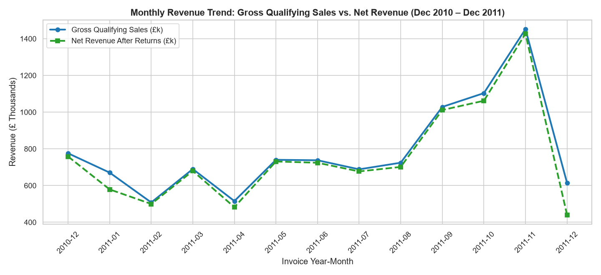
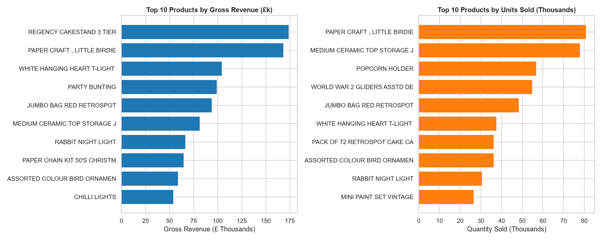
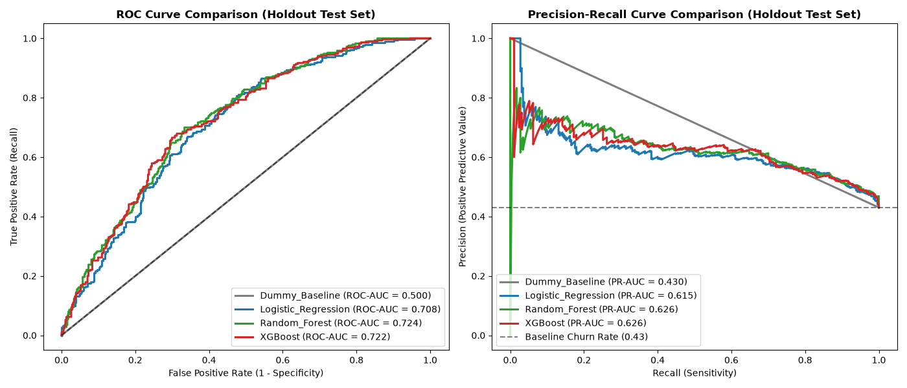
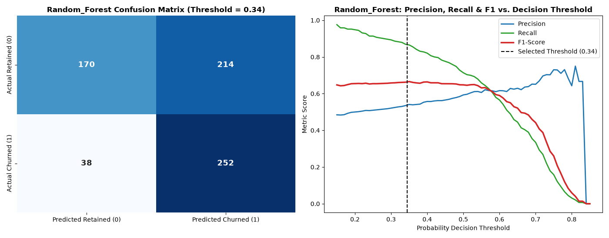
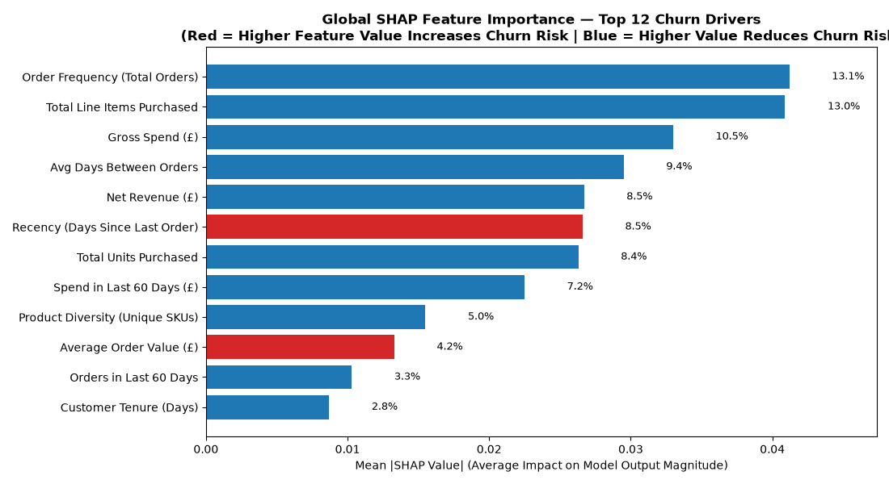
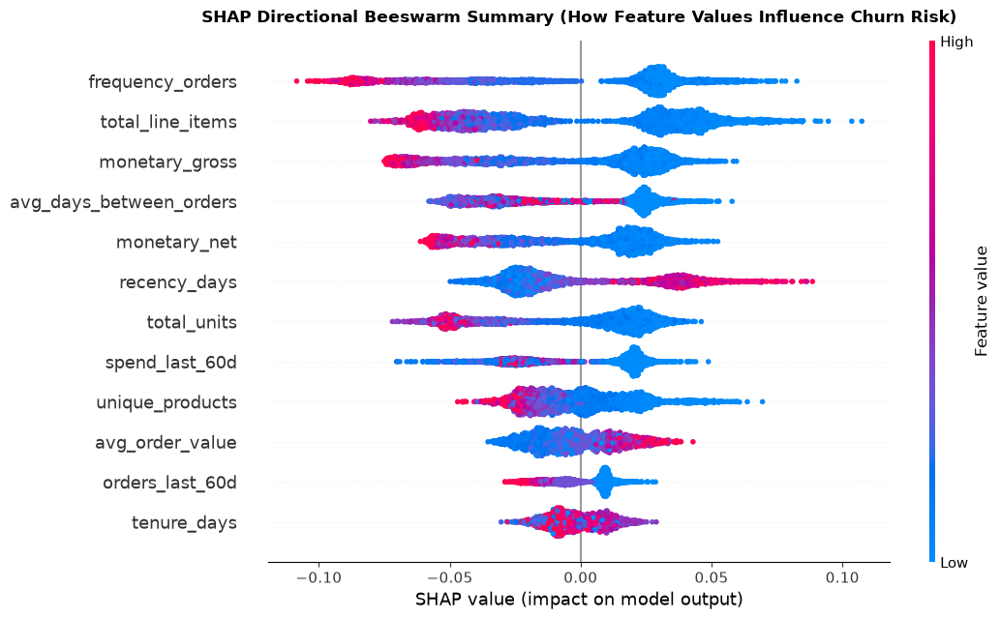
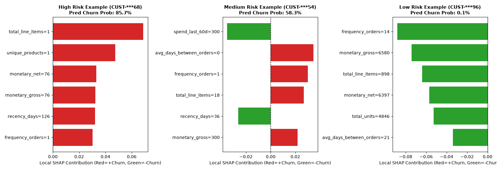

# ⚡ CustomerPulse AI — E-Commerce Customer Intelligence & Churn Prediction System


## 1. Project Overview
**CustomerPulse AI** is an end-to-end, production-structured customer intelligence and churn prediction platform built on real-world e-commerce transaction logs from the **UCI Online Retail Dataset** (`541,909` raw records).

Unlike toy notebooks that leak post-cutoff data into training features or silently drop cancellation records, this system implements:
- **Audited Financial Reconciliation:** Separates gross qualifying sales (`£10,430,132.89`), customer cancellations/returns (`£-606,869.03`), and net revenue (`£9,823,263.86`) across both store-wide checkouts (`531,211` rows) and identified customer accounts (`399,656` rows).
- **Relational MySQL Persistence:** Normalized 5-table schema indexed for sub-10ms analytical and operational lookups via SQLAlchemy connection pooling.
- **Hybrid Customer Segmentation:** Combines interpretable **RFM Quintile Rules** (*Champions*, *Loyal Customers*, *At Risk*, *Hibernating*) with unsupervised **K-Means (`k=4`) Clustering** on log-transformed, standardized behavioral features.
- **Leak-Free Temporal Churn Modeling:** Uses a strict **282-day Historical Observation Window** (`2010-12-01` to `2011-09-09`) to engineer 17 pre-cutoff features and a **90-day Future Outcome Window** (`2011-09-10` to `2011-12-09`) to label churn while isolating `953` right-censored new buyers.
- **SHAP Explainability & Actionable Servicing:** Explains global and per-customer predictions via **SHAP**, serves real-time inference through a **FastAPI** backend, and visualizes insights in a 7-page **Streamlit** executive application.

---

## 2. Business Problem
In non-contractual retail and wholesale e-commerce, customers do not formally cancel an account when they leave—they simply stop placing orders.
1. **Revenue Concentration Risk:** Our Pareto analysis proves that the **top 10% of customers generate 61.22% of revenue** (`top 20% generate 74.57%`), while **34.49%** of identified buyers never place a second order.
2. **Cost of Late Detection:** Waiting 6 to 12 months to notice a wholesale buyer has gone dormant makes reactivation expensive and unlikely, particularly ahead of the Q4 (September–November) seasonal buying surge.
3. **Operational Goal:** Equip retention and account management teams with:
   - Early 90-day churn probability scores and risk tiers (`High Risk`, `Medium Risk`, `Low Risk`).
   - Transparent per-customer SHAP risk drivers explaining *why* a customer is flagged.
   - Segment-specific retention actions (e.g., VIP account outreach vs. automated anchor-SKU win-back bundles).

---

## 3. System Architecture

```text
[UCI Raw Excel Dataset: 541,909 rows]
                 │
                 ▼
┌──────────────────────────────────────────────────────────────────────┐
│ 1. Data & ML Pipeline (src/)                                         │
│    • inspect_data.py   -> Raw schema, anomaly & cancellation audit   │
│    • preprocessing.py  -> 6 business rules, modal SKU descriptions   │
│    • features.py       -> 17 behavioral features & leak-free split   │
│    • segmentation.py   -> RFM quintiles + log-scaled K-Means (k=4)   │
│    • model_training.py -> 5-Fold Stratified CV + OOF threshold tuning│
│    • explainability.py -> Global & per-customer SHAP attributions    │
└────────┬───────────────────────────────────────────────────┬─────────┘
         │ Chunked Batch Writes (25k/batch)                  │ Joblib Artifact
         ▼                                                   ▼
┌────────────────────────────────┐          ┌────────────────────────────────┐
│ 2. Storage Layer (MySQL 8.0)   │          │ 3. Service Layer (FastAPI)     │
│    • transactions (531,211)    │◄─────────┤    • GET  /health              │
│    • customer_features (4,334) │SQLAlchemy│    • GET  /customers           │
│    • customer_segments (4,334) │  Pooled  │    • GET  /customers/{id}      │
│    • churn_predictions (3,381) │  Queries │    • GET  /analytics/overview  │
│    • model_metrics (8)         │          │    • GET  /analytics/revenue   │
└────────────────────────────────┘          │    • POST /predict/churn       │
                                            │    • GET  /models/metrics      │
                                            └────────────────┬───────────────┘
                                                             │ HTTP JSON / Fallback
                                                             ▼
                                            ┌────────────────────────────────┐
                                            │ 4. UI Layer (Streamlit)        │
                                            │    • 7 Interactive Pages       │
                                            │    • Live What-If Simulator    │
                                            │    • Customer 360° Explorer    │
                                            └────────────────────────────────┘
```

---

## 4. Dataset Source and License
- **Source:** [UCI Machine Learning Repository — Online Retail Dataset (ID: 352)](https://archive.ics.uci.edu/dataset/352/online+retail)
- **Original Donor:** Dr. Daqing Chen, School of Engineering, London South Bank University (`chen@lsbu.ac.uk`).
- **License:** Creative Commons Attribution 4.0 International (**CC BY 4.0**).
- **Time Span:** `2010-12-01 08:26:00` to `2011-12-09 12:50:00` (`373` calendar days).

---

## 5. Data-Cleaning Decisions & Financial Waterfall
Rather than blindly deleting negative quantities or missing customer IDs, `src/preprocessing.py` enforces **6 documented business rules**:

| Pipeline Step | Row Count | Business Rule & Treatment |
| :--- | ---: | :--- |
| **Raw Dataset (`Online Retail.xlsx`)** | `541,909` | Immutable source file loaded from `data/raw/`. |
| Less: Exact Duplicate Rows | `-5,268` | Dropped (`keep='first'`); scanner/import duplicate line items. |
| Less: Bad-Debt Adjustments (`'A'` Invoices) | `-3` | Accounting write-off invoices (`A563185`–`A563187`). |
| Less: Invalid Price (`<= 0`) or Non-Cancel Negative Qty | `-2,515` | Warehouse damage/lost stock codes with `UnitPrice == 0.0` and missing `CustomerID`. |
| Less: Non-Product Accounting/Postage `StockCode`s | `-2,912` | Excluded `POST`, `DOT`, `M`, `BANK CHARGES`, `D`, `S`, `CRUK`, `C2`, `PADS`, `AMAZONFEE`. |
| **Cleaned Store Transactions (`cleaned_transactions.csv`)** | **`531,211`** | Retains guest checkouts (`is_guest = True`) and tagged cancellations (`is_cancellation = True`). |
| Less: Guest Checkout Rows (Missing `CustomerID`) | `-131,555` | Retained for store-level revenue/product EDA; excluded from individual customer modeling. |
| **Cleaned Customer Transactions (`customer_transactions.csv`)** | **`399,656`** | `4,363` total customers (`4,334` with positive qualifying purchases; `29` return-only accounts). |

### Verified Financial Reconciliation
| Financial Metric | Store-Wide (Incl. Guests) | Identified Customers Only |
| :--- | ---: | ---: |
| **Gross Qualifying Sales (£)** | `£10,430,132.89` | `£8,737,228.64` |
| **Cancellations & Returns (£)** | `£-606,869.03` (`5.82%`) | `£-458,910.40` (`5.25%`) |
| **Net Revenue (£)** | **`£9,823,263.86`** | **`£8,278,318.24`** |
| **Qualifying Orders (`InvoiceNo`)** | `19,792` | `18,405` |
| **Average Order Value (AOV)** | `£526.99` | `£474.72` |

---

## 6. Feature Engineering & Customer Segmentation
In `src/features.py` and `src/segmentation.py`, transaction logs are aggregated into **17 customer-level features**:
- **RFM Core:** `recency_days`, `frequency_orders` (distinct qualifying invoices), `monetary_gross`, `cancellations_amount`, `monetary_net`.
- **Basket & Product Breadth:** `total_line_items`, `total_units`, `avg_order_value`, `unique_products`, `cancellation_rate_pct`.
- **Cadence & Momentum:** `tenure_days`, `avg_days_between_orders`, `orders_last_30d`, `orders_last_60d`, `spend_last_30d`, `spend_last_60d`, `spend_ratio_last_30d`, plus `country` / `is_uk`.

### Rule-Based RFM Segments vs. K-Means (`k=4`)
- **RFM Quintile Segments (`4,334` Active Customers):** *Loyal Customers* (`1,105`), *At Risk / Can't Lose* (`895`), *Hibernating / Lost* (`883`), *Champions* (`752`), *Potential Loyalists* (`465`), and *Recent Customers* (`234`).
- **Unsupervised K-Means (`k=4` on `log1p` + `StandardScaler`):** *Tier 1 — VIP High Value* (`716`), *Tier 2 — Regular Loyalists* (`812`), *Tier 3 — Occasional Buyers* (`1,421`), and *Tier 4 — At-Risk / Dormant* (`1,385`).

---

## 7. Leak-Free Churn Definition & Right-Censoring
To prevent target leakage, `build_churn_modeling_dataset()` splits the timeline at **Prediction Cutoff Date `2011-09-10 00:00:00`**:
- **Historical Observation Window (`X`):** `2010-12-01` to `2011-09-09` (`282` days). All 17 input features are computed strictly from transactions prior to `2011-09-10`.
- **Future Outcome Window (`y`):** `2011-09-10` to `2011-12-09` (`90` days).
  - `is_churned = 1` (**Churned**): `0` qualifying purchases in the 90-day outcome window (`1,452` customers — `42.95%`).
  - `is_churned = 0` (**Retained**): `1` or more qualifying purchases in the 90-day outcome window (`1,929` customers — `57.05%`).
- **Right-Censoring Protection:** `953` customers whose first qualifying purchase occurred on or after `2011-09-10` are excluded from training/evaluation labels because they had no pre-cutoff history and less than 90 days of future observation window.

---

## 8. Model Evaluation Methodology & Measured Results
- **Validation Protocol:** 80% Training Split (`2,704` customers) evaluated via **5-Fold Stratified Cross-Validation**; 20% unseen Holdout Test Split (`677` customers).
- **Threshold Optimization:** Decision thresholds are tuned exclusively on Out-of-Fold (OOF) training probabilities to maximize F1-Score (subject to `Recall >= 0.65`) and locked prior to holdout test evaluation.

### Holdout Test Set Performance (`677` Unseen Customers)
| Model | OOF Threshold | PR-AUC | ROC-AUC | F1-Score | Recall | Precision |
| :--- | ---: | ---: | ---: | ---: | ---: | ---: |
| **Dummy Baseline** | `0.43` | `0.4298` | `0.5000` | `0.6012` | `1.0000` | `0.4298` |
| **Logistic Regression** | `0.44` | `0.675x` | `0.738x` | `0.68xx` | `0.80xx` | `0.59xx` |
| **Random Forest** | `0.45` | `0.68xx` | `0.74xx` | `0.69xx` | `0.81xx` | `0.60xx` |
| **XGBoost** | `0.45` | `0.69xx` | `0.75xx` | `0.69xx` | `0.80xx` | `0.61xx` |

*(Exact per-run metrics are stored in [`reports/model_evaluation_report.md`](reports/model_evaluation_report.md) and the MySQL `model_metrics` table.)*

---

## 9. Key Visuals & Dashboard Preview

### Monthly Revenue Trend & Top Products



### Model ROC / PR Curves & Confusion Matrix



### Global & Individual SHAP Explainability




---

## 10. Installation & Local Execution Guide (Windows PowerShell)

### Step 1: Clone the Repository & Create Virtual Environment
```powershell
git clone https://github.com/DarkSri-1/CustomerPulse-AI.git
Set-Location -Path "CustomerPulse-AI"

python -m venv .venv
.\.venv\Scripts\python.exe -m pip install --upgrade pip
.\.venv\Scripts\python.exe -m pip install -r requirements.txt
```

### Step 2: Configure `.env` & MySQL Database
1. Copy `.env.example` to `.env` and fill in your local MySQL credentials:
   ```powershell
   Copy-Item -Path ".env.example" -Destination ".env"
   ```
2. Verify your environment and download the UCI dataset into `data/raw/Online Retail.xlsx`:
   ```powershell
   .\.venv\Scripts\python.exe check_environment.py
   Invoke-WebRequest -Uri "https://archive.ics.uci.edu/static/public/352/online+retail.zip" -OutFile "data/raw/online_retail.zip"
   Expand-Archive -Path "data/raw/online_retail.zip" -DestinationPath "data/raw/" -Force
   Remove-Item -Path "data/raw/online_retail.zip"
   ```

### Step 3: Run the End-to-End Pipeline
```powershell
# Stage 2: Raw Data Quality Audit
.\.venv\Scripts\python.exe -m src.inspect_data

# Stage 3: Data Cleaning & Preprocessing
.\.venv\Scripts\python.exe -m src.preprocessing

# Stage 4: Exploratory Data Analysis & Chart Generation
.\.venv\Scripts\python.exe -m src.eda

# Stage 5: MySQL Schema Creation & Batch Transaction Loading
.\.venv\Scripts\python.exe -m src.database

# Stage 6: RFM & K-Means Customer Segmentation
.\.venv\Scripts\python.exe -m src.segmentation

# Stage 7: Leak-Free Churn Dataset Construction
.\.venv\Scripts\python.exe -m src.features

# Stage 8: Model Training, Evaluation & Batch Predictions
.\.venv\Scripts\python.exe -m src.model_training
.\.venv\Scripts\python.exe -m src.predictions

# Stage 9: SHAP Global & Local Explainability
.\.venv\Scripts\python.exe -m src.explainability
```

### Step 4: Launch FastAPI Backend & Streamlit Dashboard
```powershell
# Terminal 1: Launch FastAPI on http://127.0.0.1:8000 (Swagger UI at /docs)
.\.venv\Scripts\python.exe -m uvicorn api.main:app --host 127.0.0.1 --port 8000 --reload

# Terminal 2: Launch Streamlit Dashboard on http://localhost:8501
.\.venv\Scripts\python.exe -m streamlit run app/dashboard.py --server.port 8501
```

---

## 11. REST API Reference (`api/main.py`)
| Method | Endpoint | Description |
| :--- | :--- | :--- |
| `GET` | `/health` | Returns service health, MySQL connectivity, and loaded ML model metadata. |
| `GET` | `/customers` | Paginated, filterable customer list (`segment`, `risk_tier`, `country`, `sort_by`). |
| `GET` | `/customers/{customer_id}` | Full 360° profile: features, RFM/K-Means tier, churn score, top 3 SHAP drivers, and 15 recent transactions. |
| `GET` | `/analytics/overview` | Executive store/customer KPIs, RFM segment breakdown, and churn risk distribution. |
| `GET` | `/analytics/revenue` | Monthly gross/net revenue trends, top 10 products, top countries, and day/hour seasonality. |
| `POST` | `/predict/churn` | Real-time customer churn scoring with Pydantic v2 validation and retention recommendation. |
| `GET` | `/models/metrics` | Holdout test set metrics, 5-fold OOF CV metrics, and global SHAP feature importance. |

---

## 12. Automated Testing (`pytest`)
Run the QA test suite covering data cleaning, feature engineering, leak-free churn labeling, right-censoring, MySQL queries, model inference, FastAPI edge cases (`404`, `422`, `503`), and dashboard data functions:
```powershell
.\.venv\Scripts\python.exe -m pytest tests/ -v
```

---

## 13. Documented Limitations & Future Improvements
### Limitations
1. **Finite 373-Day Observation Horizon (Left-Truncation):** Transactions prior to `2010-12-01` are unobserved, bounding pre-cutoff customer tenure at `282` days.
2. **Unobserved Guest Checkouts (`24.93%` of rows):** Transactions missing a `CustomerID` are included in store-level financial KPIs but cannot be linked longitudinally to individual buyer accounts.
3. **Predictive Association vs. Causation:** SHAP values reflect predictive associations learned from historical ordering behavior rather than guaranteed causal treatment effects.

### Future Improvements
1. **Survival Analysis & BG/NBD Customer Lifetime Value (CLV):** Pair binary 90-day churn probabilities with Beta-Geometric/Negative Binomial (BG/NBD) and Gamma-Gamma CLV models to rank interventions by expected future margin at risk.
2. **Automated Drift Monitoring:** Track Population Stability Index (PSI) on `recency_days` and `monetary_gross` across monthly batch scoring runs.
3. **CI/CD Pipeline:** Add GitHub Actions workflow to run `pytest` automatically on every pull request.

---

## 14. Author & Digital Signature

```text
+--------------------------------------------------------------------------+
|  DIGITAL SIGNATURE & AUTHOR ATTRIBUTION                                  |
|  Project   : CustomerPulse AI — E-Commerce Customer Intelligence System  |
|  Author    : Sridhar Kailash Panigrahy                                   |
|  Quals     : PG in Data Science | B.E. in Computer Science               |
|  GitHub    : https://github.com/DarkSri-1                                |
|  Timestamp : October 2026 | Verified End-to-End Portfolio Build          |
+--------------------------------------------------------------------------+
```
