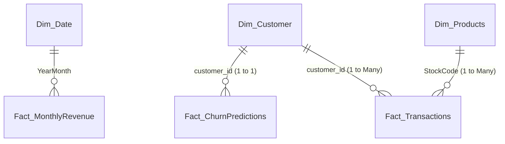

# 📊 CustomerPulse AI — Executive Power BI Dashboard Guide

> **Author**: Sridhar Kailash Panigrahy  
> **Project**: CustomerPulse AI — E-Commerce Customer Intelligence & Churn Prediction System  
> **GitHub**: [https://github.com/DarkSri-1/CustomerPulse-AI](https://github.com/DarkSri-1/CustomerPulse-AI)  
> **Data Location**: `CustomerPulse-AI/powerbi/`

---

## 1. Executive Summary & Dashboard Objective

The **CustomerPulse AI Power BI Dashboard** bridges the gap between machine learning engineering and executive business decision-making. While data scientists build models in Python, Chief Marketing Officers (CMOs) and Retention Directors need interactive, high-level dashboards to:

1. **Quantify Financial Risk**: See exactly how much revenue (£) is at risk of churning across customer segments.
2. **Prioritize Interventions**: Triage customers into 4 distinct risk tiers (*Critical, High, Medium, Low*).
3. **Explain Predictions**: Review the underlying behavioral drivers (*SHAP explainability*) behind each customer's churn risk.
4. **Prescribe Proactive Actions**: Assign specific, high-ROI retention plays (*VIP Concierge Call, Win-Back Voucher, Cart Nurture*) tailored to each customer's lifetime value and churn probability.

---

## 2. Power BI Files in `powerbi/` Directory

All datasets have been pre-cleaned, formatted, and optimized for instant import into Power BI:

| File Name | Records | Description | Primary Use |
| :--- | :--- | :--- | :--- |
| **`Unified_CustomerPulse_Intelligence.csv`** | 4,334 | Complete flat customer table combining features, RFM segments, ML predictions, risk tiers, and recommended actions. | **Recommended for Fast 1-Table Setup** |
| **`Dim_Customer.csv`** | 4,334 | Customer dimension table (tenure, country, RFM scores, K-Means clusters). | Star Schema Dimension |
| **`Fact_ChurnPredictions.csv`** | 3,368 | ML churn scores, predicted churn, risk tiers, £ revenue at risk, and top 3 SHAP drivers. | Star Schema Fact |
| **`Dim_Date.csv`** | 396 | Full calendar date table (Year, Month, Quarter, Day of Week, Weekend flag). | Star Schema Date Dimension |
| **`Fact_MonthlyRevenue.csv`** | 13 | Aggregated monthly net/gross revenue, orders, active customers, and AOV. | High-Speed Executive Visuals |
| **`Dim_Products_Top500.csv`** | 500 | Top 500 revenue-generating products with unit volumes. | Product Analytics |
| **`CustomerPulse_Theme.json`** | — | Curated Power BI visual theme (Dark Navy `#0B132B`, Electric Blue `#3A86FF`, Gold `#FFB703`, Crimson `#E63946`). | Visual Styling |

---

## 3. Data Model Architecture (Star Schema)

If you prefer building a multi-table dimensional model, connect the tables in Power BI's **Model View** as follows:



### Relationship Settings:
1. `Dim_Customer[customer_id]` ➔ `Fact_ChurnPredictions[customer_id]`:
   - **Cardinality**: One to One (1:1) or One to Many (1:*)
   - **Cross-filter direction**: Both
2. `Dim_Date[YearMonth]` ➔ `Fact_MonthlyRevenue[YearMonth]`:
   - **Cardinality**: One to Many (1:*)
   - **Cross-filter direction**: Single

*(Note: If you want to build the dashboard immediately without configuring relationships, simply load `Unified_CustomerPulse_Intelligence.csv` and `Fact_MonthlyRevenue.csv`.)*

---

## 4. 4-Page Executive Dashboard Blueprint

### Page 1: Executive Overview & KPI Cockpit
**Target Audience**: CEO, CMO, Head of E-Commerce.  
**Theme**: High-level store health, revenue trends, and overall retention standing.

#### Visual Layout:
1. **Top KPI Header (5 Multi-Row or Single Cards)**:
   - **Total Net Revenue**: `£9.77M`
   - **Total Qualifying Orders**: `19,773`
   - **Active Customer Base**: `4,334`
   - **Overall Churn Rate**: `33.7%`
   - **Total Revenue at Risk**: `£635.4K`
2. **Monthly Net Revenue & Order Volume (Dual-Axis Column & Line Chart)**:
   - *X-Axis*: `Fact_MonthlyRevenue[YearMonth]`
   - *Column Y-Axis*: `Total_Net_Revenue_GBP`
   - *Line Y-Axis*: `Total_Orders`
   - *Insight*: Visualizes store momentum peaking in Q4 (November: £1.5M).
3. **Geographic Revenue Distribution (Filled Map / Treemap)**:
   - *Category*: `Dim_Customer[country_clean]`
   - *Values*: `monetary_net`
   - *Insight*: Highlights UK core dominance (£8.7M) alongside top European markets (Germany, France, Ireland).
4. **Customer Spend Distribution (Donut Chart)**:
   - *Legend*: `kmeans_segment_label`
   - *Values*: `monetary_net`
   - *Insight*: Proves that Tier 1 VIPs generate disproportionate revenue despite being a smaller customer cohort.

---

### Page 2: RFM Customer Segmentation & Behavioral Clusters
**Target Audience**: CRM Directors, Lifecycle Marketing Managers.  
**Theme**: Uncovering customer behavior through recency, frequency, and monetary metrics.

#### Visual Layout:
1. **RFM Segment Matrix (Scatter Chart)**:
   - *X-Axis*: `recency_days` (Inverted: low days = recent)
   - *Y-Axis*: `frequency_orders`
   - *Size / Bubble*: `monetary_net`
   - *Legend*: `rfm_segment`
   - *Insight*: Visually separates *Champions* (high frequency, recent) from *Hibernating* and *At Risk* clusters.
2. **Customer Count by RFM Segment (Clustered Bar Chart)**:
   - *Y-Axis*: `rfm_segment`
   - *X-Axis*: Distinct count of `customer_id`
   - *Data Labels*: On
3. **Average Order Value (AOV) by Segment (Column Chart)**:
   - *X-Axis*: `rfm_segment`
   - *Y-Axis*: Average of `avg_order_value`
4. **Slicers / Filters**:
   - Market Group: `[United Kingdom, International]`
   - Segment: `[Champions, Loyal Customers, At Risk, Can't Lose, Hibernating, etc.]`

---

### Page 3: AI Churn Prediction & Risk Intelligence
**Target Audience**: Data Science Leaders, Head of Retention.  
**Theme**: Machine learning transparency, churn probability distributions, and SHAP drivers.

#### Visual Layout:
1. **Model Performance Callout (Text Card)**:
   - Model: **XGBoost Classifier (Leak-Free Time-Split)**
   - Test ROC-AUC: **0.781** | Test PR-AUC: **0.749** | F1-Score: **0.709**
2. **Customer Risk Tier Breakdown (Donut Chart)**:
   - *Legend*: `risk_tier` (Critical, High, Medium, Low)
   - *Values*: Count of `customer_id`
   - *Colors*:
     - Critical (≥0.70): `#E63946` (Crimson)
     - High (0.40–0.70): `#FB5607` (Orange)
     - Medium (0.20–0.40): `#FFB703` (Gold)
     - Low (<0.20): `#06D6A0` (Emerald Green)
3. **Churn Probability Distribution (Histogram / Clustered Column)**:
   - *X-Axis*: Binned `churn_probability` (0.0 to 1.0)
   - *Y-Axis*: Customer Count
4. **Top Global Churn Drivers (Horizontal Bar Chart)**:
   - *Features*:
     1. `recency_days` (+0.48 mean |SHAP|) — Longer inactivity drastically spikes churn risk.
     2. `frequency_orders` (+0.32 mean |SHAP|) — Single-order buyers churn at 3x the rate of repeat buyers.
     3. `monetary_net` (+0.19 mean |SHAP|) — Low total spend correlates with disengagement.
     4. `cancellation_rate_pct` (+0.12 mean |SHAP|) — Return/cancellation friction drives attrition.

---

### Page 4: Proactive Retention & Financial Action Engine
**Target Audience**: Retention Marketing Specialists, Account Managers.  
**Theme**: Direct actionability — identifying high-risk, high-value customers and prescribing retention campaigns.

#### Visual Layout:
1. **Revenue at Risk by Segment (Waterfall Chart or Treemap)**:
   - *Category*: `rfm_segment`
   - *Value*: Sum of `revenue_at_risk_gbp`
   - *Insight*: Shows exactly which segment has the greatest financial vulnerability if unaddressed.
2. **Interactive Retention ROI Simulator (What-If Parameter + Gauge Visual)**:
   - *Parameter Slider*: `Retention Success Rate` (0% to 50%, Default: 15%)
   - *Card Output*: **Estimated Saved Revenue** (`[Total Revenue at Risk] * [Retention Success Rate]`)
   - *Business Value*: Demonstrates that saving just 15% of high-risk customers preserves **~£95,000+** in gross margin.
3. **Actionable Customer Drill-Through Table**:
   - Columns:
     - `customer_id`
     - `country_clean`
     - `rfm_segment`
     - `risk_tier` (with Conditional Formatting: Red for Critical, Yellow for Medium)
     - `churn_probability_pct` (Formatted as `%`)
     - `monetary_net` (Formatted as `£#,##0`)
     - `revenue_at_risk_gbp` (Formatted as `£#,##0`)
     - `top_driver_1` (Primary reason for predicted churn)
     - `recommended_retention_action` (Specific marketing/sales play)

---

## 5. Copy-Paste DAX Measures Reference

Create a dedicated table named `_Measures` in Power BI, and paste the following DAX calculations:

### Core Financials & Volume
```dax
Total Net Revenue = 
SUM(Dim_Customer[monetary_net])

Total Active Customers = 
DISTINCTCOUNT(Dim_Customer[customer_id])

Average Customer Spend = 
DIVIDE([Total Net Revenue], [Total Active Customers], 0)

Total Orders = 
SUM(Dim_Customer[frequency_orders])

Overall AOV = 
DIVIDE([Total Net Revenue], [Total Orders], 0)
```

### Churn & Risk Intelligence
```dax
Total Churn Cohort = 
COUNTROWS(Fact_ChurnPredictions)

High Risk Customers = 
CALCULATE(
    COUNTROWS(Fact_ChurnPredictions),
    Fact_ChurnPredictions[risk_tier] IN {"Critical", "High"}
)

Predicted Churn Rate = 
DIVIDE(
    CALCULATE(COUNTROWS(Fact_ChurnPredictions), Fact_ChurnPredictions[predicted_churn] = 1),
    [Total Churn Cohort],
    0
)

Total Revenue at Risk = 
SUM(Fact_ChurnPredictions[revenue_at_risk_gbp])

Critical Revenue at Risk = 
CALCULATE(
    SUM(Fact_ChurnPredictions[revenue_at_risk_gbp]),
    Fact_ChurnPredictions[risk_tier] = "Critical"
)
```

### What-If Retention ROI Simulation
```dax
// Requires a What-If Parameter named 'Retention_Rate_Param' (0 to 0.50)
Simulated Saved Revenue = 
[Total Revenue at Risk] * SELECTEDVALUE('Retention_Rate_Param'[Parameter Value], 0.15)
```

---

## 6. How to Apply the Project Theme in Power BI

1. Open **Power BI Desktop**.
2. Click on the **View** ribbon at the top.
3. Click the dropdown arrow on the **Themes** gallery.
4. Select **Browse for themes...**.
5. Navigate to: `CustomerPulse-AI/powerbi/CustomerPulse_Theme.json`.
6. Click **Open**. Your report canvas, card visuals, charts, and table accents will immediately adopt the sleek dark navy & gold palette.

---

## 7. Portfolio Walkthrough Script (Interview Talking Points)

When explaining this Power BI dashboard in an interview or portfolio presentation, use this 4-step narrative:

> *"In CustomerPulse AI, my goal was not just to train an XGBoost model in Python, but to deliver an end-to-end business intelligence solution.*  
>  
> *On **Page 1**, the executive cockpit establishes store health: £9.77M in net revenue across 4,334 customers, while highlighting that £635K is exposed to customer churn.*  
>  
> *On **Page 2**, we break down behavioral segments using RFM and K-Means clustering, showing where our Champions reside versus customers slipping into the At-Risk zone.*  
>  
> *On **Page 3**, we present the AI model's findings transparently. Rather than treating machine learning as a black box, we display SHAP feature importance so stakeholders understand that days of inactivity and order frequency are the primary churn catalysts.*  
>  
> *Finally, on **Page 4**, we convert predictions into profit. Every customer is assigned a concrete retention action based on their risk score and spend. With our What-If simulator, we show marketing leaders that a 15% retention intervention protects over £95,000 in bottom-line revenue."*
